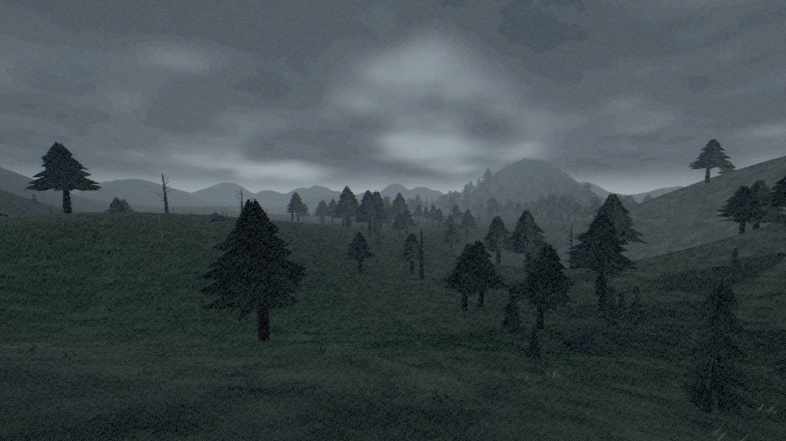

# Horizon Walk / Quiet Shore

[Play the browser demo](https://horizon-walk.vercel.app/)

Horizon Walk is my own atmospheric 3D exploration game, built with TypeScript and Three.js/WebGL2. The player walks through procedural landscapes, follows views and landmarks, and discovers small traces of life in the world. Rain, fog, distant terrain and a grain/VHS treatment establish the visual direction.

## What the project demonstrates

- Interactive 3D rendering and procedural landscapes in a browser.
- First-person movement and collisions, with an optional bunny-hop mode.
- Reproducible worlds that can be opened by a world code.
- Quality and resolution settings, pause handling and photo mode.
- A pocket/profile with discoveries and local progress stored across worlds in the same browser.
- A built-in repeatable route, manual recording and frame-time reports to investigate performance on a stated device and configuration.

The emphasis is on exploration and atmosphere. This is an independent project in development, separate from my commercial client work.

## Try it

Open the demo on a computer and select Начать (Start). Use WASD or the arrow keys to move, Shift to run, Space to jump and the mouse to look around. If pointer lock is unavailable, hold the mouse button to look. Escape pauses the game. I opens the pocket/profile and P opens photo mode. Settings include the current world code, graphics options and the repeatable performance route.

## Engineering discussion

The interesting trade-offs are rendering a large view with a limited frame budget, keeping movement consistent, managing scenery as the player travels, and saving progress without a backend account. The performance report exposes viewport and render resolution, frame-time percentiles, CPU/GPU measurements when supported and warnings, so a result can be discussed with its conditions.

A short route on one computer is not a performance guarantee for all devices. Physical phones and long sessions need separate validation. The project currently targets desktop play; mobile support should be assessed on actual devices.

## My role

My work on the project covers the exploration experience, rendering, movement, application state, verification and iteration. The screenshot is a photo captured inside the running game. This is my independent project, separate from client work under NDA.

