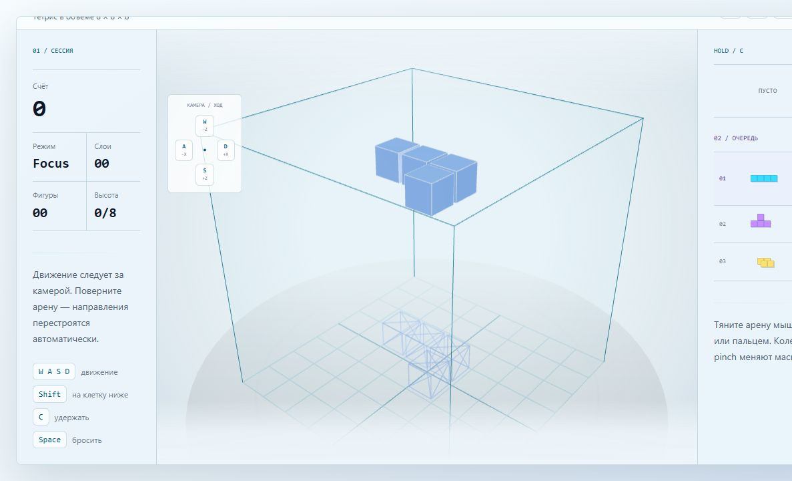
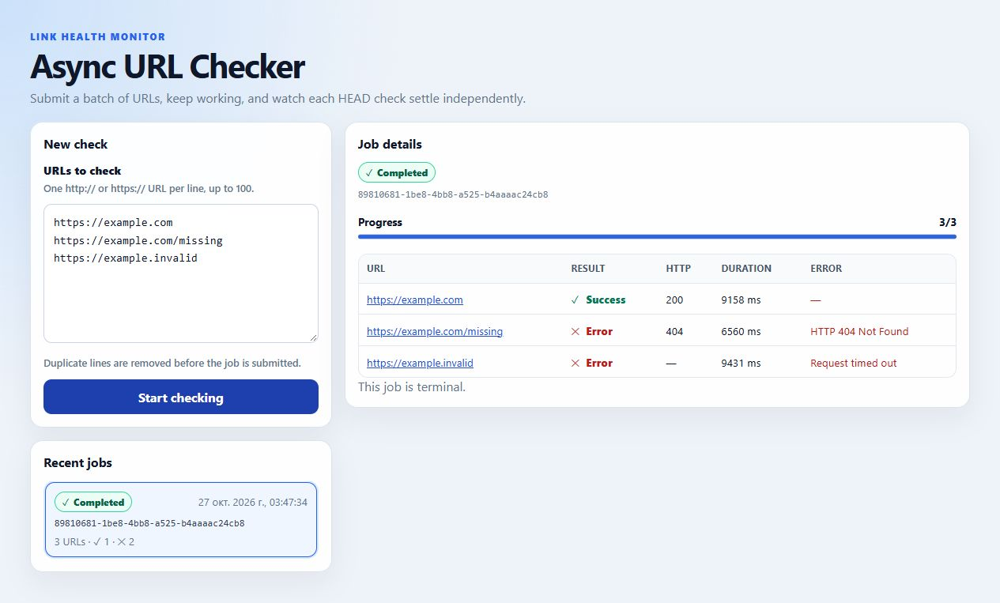

# Dmitry Mikhailov

**React / Next.js / TypeScript developer** for responsive interfaces, API integrations and focused website fixes.

I take a defined task from reproduction to a verified patch, with agreed acceptance criteria and a clear handover. Open to remote frontend roles and paid milestones; based in Kemerovo, Russia (UTC+7), self-employed.

[Interactive demo](https://voxel-drop-3d.vercel.app/) · [API and state case](ASYNC-URL-CHECKER-CASE-EN.md) · [Public CV](Dmitry_Mikhailov_CV_EN_PUBLIC.pdf)

## See the work

### Voxel Drop 3D - interactive frontend

My own React/TypeScript/Three.js browser puzzle: a deterministic game engine, camera-relative controls, local progress and automated checks. A practical example of complex UI state and interactive 3D.

[Play demo](https://voxel-drop-3d.vercel.app/) · [Source](https://github.com/fsaidad/voxel-drop-3d) · [English walkthrough](VOXEL-DROP-CASE-EN.md)

### Async URL Checker - tested integration and state handling

A NestJS + React/RTK Query technical assignment with bounded concurrency, cancellation, progress reporting, Docker and automated tests. The README explains in-memory storage and deployment limitations.

[Source and setup](https://github.com/fsaidad/async-url-checker) · [Engineering case](ASYNC-URL-CHECKER-CASE-EN.md) · [Reproducible React regression example](REACT-ASYNC-REGRESSION-EN.md)

These public examples are independent projects and a technical assignment. They are separate from my commercial client work.

## Commercial background

- **Jan-Jul 2026 - frontend/content delivery under NDA:** two multilingual projects, around 5,000 pages in 10+ locales; JavaScript/Markdown processing, internal-link validation and technical SEO.
- **Aug 2023-Apr 2026 - independent client projects:** React/Next.js interfaces, Figma implementation, API integration, client state, performance profiling and Jest/Vitest tests. These periods partly overlap.
- [Client feedback on Kwork](https://kwork.ru/user/fsaidad#reviews): two completed orders with positive reviews for urgent web work and clear delivery steps.

## Work with me

Send the problem, expected result, reproduction steps and relevant code or screenshots. We can agree on one paid task or milestone with a defined handover.

- Email: [fsaidad54673@ya.ru](mailto:fsaidad54673@ya.ru)
- Telegram: [@core_broken](https://t.me/core_broken)
- [Public CV](Dmitry_Mikhailov_CV_EN_PUBLIC.pdf)
- Location: Kemerovo, Russia · UTC+7 · remote
- English: B1; written communication preferred

